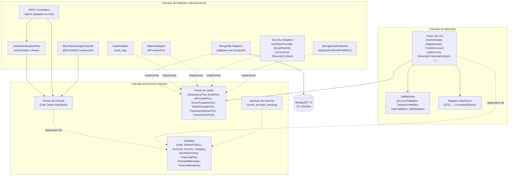
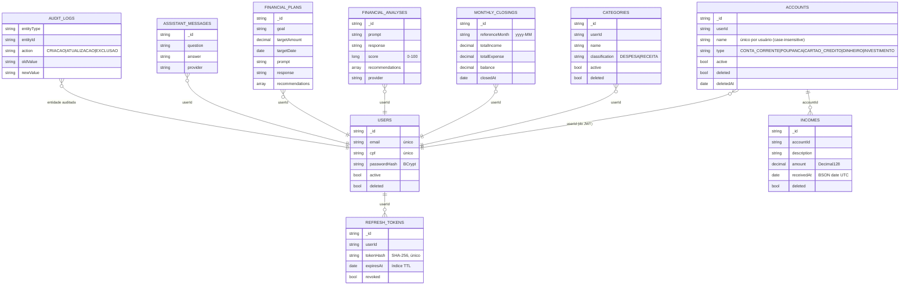
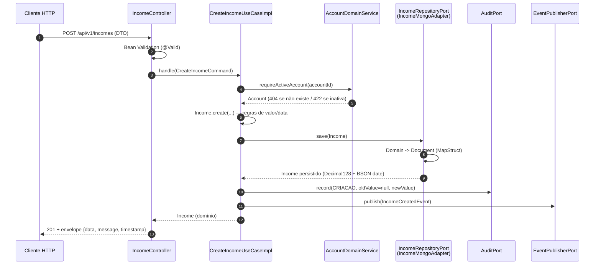
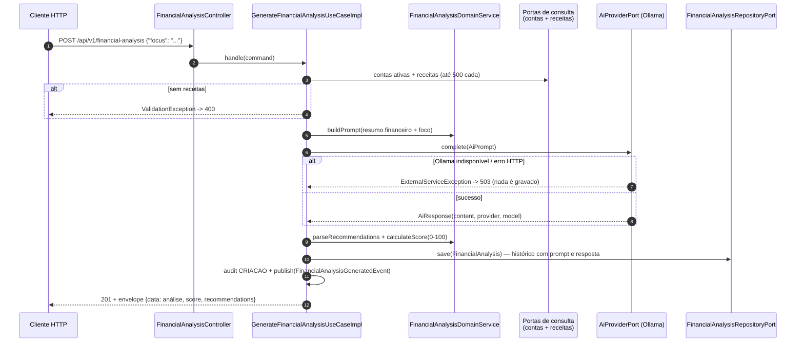
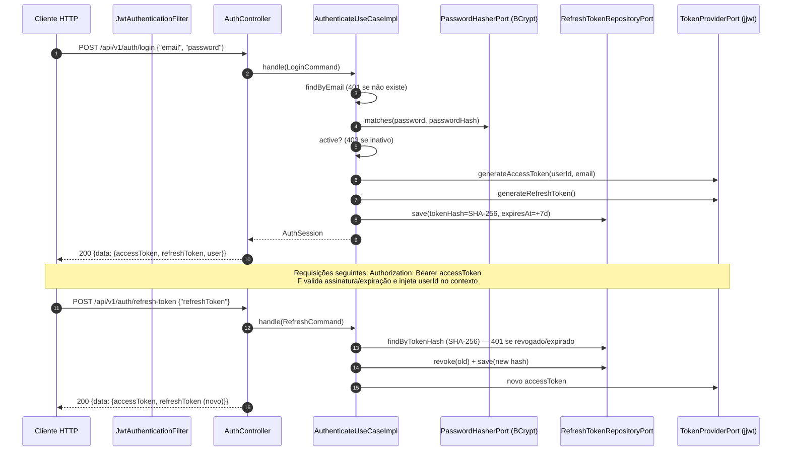
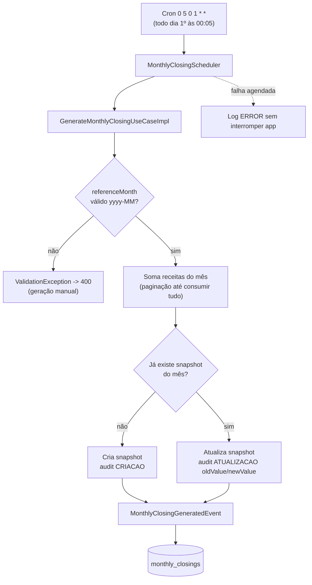

# Arquitetura — IA-Financial

Sistema de controle financeiro pessoal com IA, em **Java 21 + Spring Boot 3.5.6**, usando
**Arquitetura Hexagonal (Ports and Adapters)** e **MongoDB**.

> Este documento é a visão de desenho (diagramas, fluxos e decisões). Os scripts de banco estão em
> [ddl-mongodb.md](ddl-mongodb.md) e [dml-mongodb.md](dml-mongodb.md); exemplos de uso em
> [postman/](postman/README.md).

---

## 1. Stack

| Camada | Tecnologia |
|---|---|
| Linguagem / Runtime | Java 21 |
| Framework | Spring Boot 3.5.16 (Web, Data MongoDB, Validation, Scheduling, Security, Actuator) |
| Banco | MongoDB 7.0 (coleções com validadores `$jsonSchema` + índices) |
| Autenticação | JWT HS256 (jjwt 0.13.0), BCrypt (spring-security-crypto), refresh token rotativo |
| Mapeamento | MapStruct (DTO ↔ domínio ↔ documento) |
| Documentação | springdoc-openapi (Swagger UI em `/swagger-ui.html`) |
| IA | Ollama (HTTP, `/api/generate`) atrás de `AiProviderPort` |
| Testes | JUnit 5, Mockito, AssertJ, MockMvc, flapdoodle (Mongo embutido), WireMock, JaCoCo (gate 90%) |

---

## 2. Visão Hexagonal



**Regra de dependência:** `domain` não depende de nada externo; `application` depende só de
`domain`; `adapters` dependem das duas. As portas de entrada são implementadas pelos casos de uso
e consumidas por controllers e scheduler; as portas de saída são implementadas pelos adapters.

---

## 3. Coleções e relacionamentos



Nota: em MongoDB não há chaves estrangeiras; as relações são lógicas (`accountId`, `userId`) e
garantidas pelos casos de uso.

---

## 4. Fluxos principais

### 4.1 Cadastro de receita (fluxo síncrono completo)



### 4.2 Análise financeira com IA (FASE 5) — mesmo padrão vale para FASES 8 e 9



### 4.3 Autenticação (login + refresh rotativo) — FASE 10



### 4.4 Fechamento mensal agendado (FASE 7)



---

## 5. Modelo de dados (resumo)

| Coleção | Uso | Índices |
|---|---|---|
| `users` | Credenciais de acesso (BCrypt; e-mail e CPF únicos) | `email` único, `cpf` único, `active`, `deleted` |
| `refresh_tokens` | Refresh tokens rotativos (hash SHA-256, TTL) | `tokenHash` único, `userId+createdAt DESC`, `expiresAt` (TTL) |
| `accounts` | Contas financeiras do usuário | `userId+name`, `type`, `active`, `deleted` |
| `incomes` | Receitas (valores em Decimal128, `receivedAt` como BSON date UTC) | `userId+receivedAt DESC`, `accountId+receivedAt DESC`, `deleted` |
| `categories` | Categorias com classificação `DESPESA`/`RECEITA` | `userId+name`, `classification`, `active`, `deleted` |
| `financial_analyses` | Histórico das análises com IA (prompt, resposta, score, recomendações) | `userId+createdAt DESC`, `deleted` |
| `monthly_closings` | Snapshots mensais do saldo | `userId+referenceMonth`, `deleted` |
| `financial_plans` | Histórico de planos de economia gerados por IA | `userId+createdAt DESC`, `deleted` |
| `assistant_messages` | Histórico de perguntas/respostas do assistente | `userId+createdAt DESC`, `deleted` |
| `audit_logs` | Trilha de auditoria de todas as mutações | `entityType+entityId`, `createdAt DESC` |

DDL completo (validadores `$jsonSchema` + `createIndex`) em [ddl-mongodb.md](ddl-mongodb.md).

### Decisões de desenho

1. **Dinheiro como `Decimal128`**: evita erro de arredondamento de `double` e permite `$sum` em
   aggregations; Spring Data serializaria `BigDecimal` como string por padrão — conversores
   customizados (`MongoConfig`) corrigem isso.
2. **`LocalDate` como BSON date (UTC)**: garante que filtros `gte/lte` por período funcionem
   numericamente (não como string).
3. **Exclusão sempre lógica** (`deleted`, `deletedAt`): histórico preservado; todas as leituras
   filtram `deleted: false`.
4. **Auditoria em coleção separada** (`audit_logs`) com `oldValue`/`newValue` serializados em JSON —
   o caso de uso decide quando registrar (`CRIACAO` = newValue, `ATUALIZACAO` = ambos,
   `EXCLUSAO` = oldValue).
5. **IA atrás de porta** (`AiProviderPort`): trocar Ollama por outro provedor não toca no domínio;
   timeouts e cliente HTTP isolados no adapter.
6. **Score deterministicamente calculado** (receitas 40 pts, contas 30, meses 30): a nota não
   depende do humor do LLM; o LLM fornece texto e recomendações.
7. **Envelope único** `{"data", "message", "timestamp"}` e erros `{"timestamp","status","error",
   "message","details"}`.
8. **Senhas com BCrypt, tokens com SHA-256**: o banco nunca guarda a senha nem o refresh token em
   claro — só o hash; o snapshot de auditoria do usuário (CRIACAO/ATUALIZACAO) contém apenas
   `id/email/cpf/active`, nunca o `passwordHash`.
9. **JWT HS256 atrás de portas** (`TokenProviderPort`, `PasswordHasherPort`, `CurrentUserPort`):
   trocar jjwt/BCrypt/SecurityContext não toca no domínio; o segredo vem de `JWT_SECRET`.
10. **Refresh token rotativo**: cada uso revoga o antigo e emite um novo (`tokenHash` único +
    índice TTL em `expiresAt`); logout revoga todos os tokens do usuário.
11. **Multiusuário pelo token**: toda leitura/escrita usa o `userId` do JWT (`CurrentUserPort`);
    controllers e adapters não recebem `userId` do cliente — usuário só edita/desativa a própria conta.

---

## 6. Semântica de erros

| Situação | HTTP | Exceção |
|---|---|---|
| Bean Validation, corpo malformado, valor ≤ 0, data futura, enum desconhecido | 400 | `ValidationException` / `MalformedRequestException` / `InvalidEnumException` |
| Não autenticado, token inválido ou expirado | 401 | `UnauthorizedException` / entrada do `JwtAuthenticationFilter` |
| Acesso proibido (usuário alheio, usuário inativo) | 403 | `ForbiddenException` |
| Recurso inexistente ou já excluído logicamente | 404 | `NotFoundException` |
| Nome duplicado (conta/categoria) ou e-mail/CPF já cadastrado | 409 | `ConflictException` |
| Regra de negócio (receita em conta inativa) | 422 | `BusinessRuleException` |
| Falha de banco | 500 | `DatabaseException` |
| Provedor de IA indisponível | 503 | `ExternalServiceException` |

Tratados centralizadamente em `GlobalExceptionHandler` (`shared.exception`).

---

## 7. Organização de pacotes

```
com.finance
├── domain          # entidades, enums, eventos, ports (in/out), serviços de domínio
├── application     # use cases (CQRS-light), commands, queries, DTOs, mappers, validadores
├── adapters.in.rest.v1          # controllers REST versionados
├── adapters.in.rest.filter      # JwtAuthenticationFilter
├── adapters.out.mongodb         # documents, repositories, persistence mappers, adapters
├── adapters.out.security        # JwtTokenProvider, BcryptPasswordHasher, CurrentUser
├── adapters.out.audit           # AuditPort -> audit_logs
├── adapters.out.events          # EventPublisherPort -> Spring events
├── adapters.out.ollama          # AiProviderPort -> Ollama HTTP
├── scheduler       # MonthlyClosingScheduler (multiusuário)
├── config          # MongoConfig, MongoSchemaInitializer, SchedulingConfig, SecurityConfig, JwtProperties, OpenAPI
├── documentation   # anotações OpenAPI
└── shared          # exceptions, handler, envelope, constants, utils
```

## 8. Como executar / testar

```bash
mvn spring-boot:run                        # aplica + Mongo local localhost:27017
mvn spring-boot:run -Dspring-boot.run.profiles=dev   # perfil dev (logs coloridos, JWT 2h)
mvn clean test               # 256 testes + gate JaCoCo 90% (Mongo embutido + WireMock)
```
